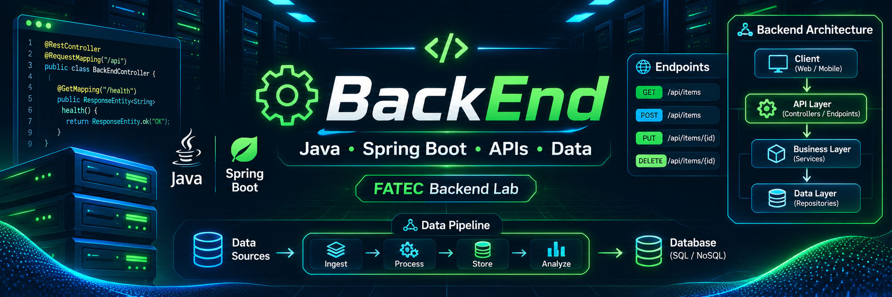

  

# Projetos Back-End

Os projetos deste antigo repositório foram separados em repositórios independentes para facilitar a consulta, execução e evolução de cada aplicação.

## Repositórios

- [Coleção de Vinis em Java](https://github.com/gilbertocorrea-cmd/ColecaoVinis.java)
- [Java: Coleções e Streams](https://github.com/gilbertocorrea-cmd/java-colecoes-streams)
- [Sistema Biblioteca com Spring Boot](https://github.com/gilbertocorrea-cmd/Sistema-Biblioteca-Spring)

## Autor

Gilberto Corrêa — Análise e Desenvolvimento de Sistemas, FATEC.

[GitHub](https://github.com/gilbertocorrea-cmd) · [LinkedIn](https://www.linkedin.com/in/gilberto-correa-t3574)
