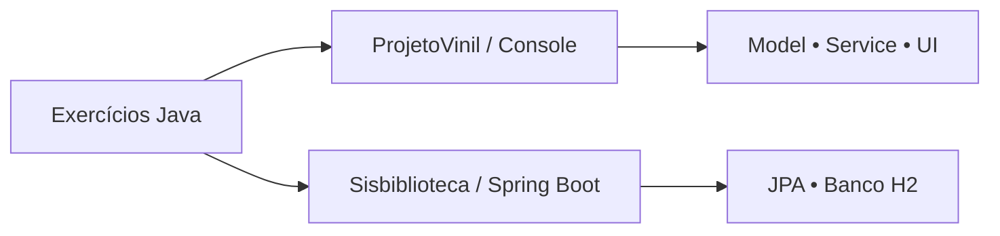

<div align="center">

# B A C K E N D　//　J A V A　L A B

### `JAVA • SPRING BOOT • JPA • CONSOLE`

**Repositório da disciplina de Programação de Scripts I (Back-End) na FATEC, com exercícios Java, o sistema de coleção de vinis e a atividade Sisbiblioteca.**


`ADS` · `FATEC` · `PROJETO ACADÊMICO`

[Visão geral](#visao-geral) · [Estrutura](#estrutura) · [Arquitetura](#arquitetura) · [Execução](#execucao)

</div>

---

<a id="visao-geral"></a>

## `PROJECT // VISÃO GERAL`

Repositório da disciplina de Programação de Scripts I (Back-End) na FATEC, com exercícios Java, o sistema de coleção de vinis e a atividade Sisbiblioteca.

## `SYSTEM // STATUS`

| Recurso | Situação |
| :--- | :---: |
| Código fonte | `● DISPONÍVEL` |
| Documentação | `● DOCUMENTADA` |
| Publicação em produção | `◉ NÃO VERIFICADA` |

<a id="estrutura"></a>

## `STRUCTURE // ARQUIVOS E MÓDULOS`

| Arquivo / pasta | Responsabilidade |
| :--- | :--- |
| [`12_08/`](12_08/) | Exemplos introdutórios em Java |
| [`ProjetoVinil/`](ProjetoVinil/) | Aplicação de coleção de discos de vinil, com model, service, repository e UI de console |
| [`sisbiblioteca/`](sisbiblioteca/) | Exercício Spring Boot com entidades Autor e Livro, repositórios JPA e inicialização de dados |

<a id="arquitetura"></a>

## `ARCHITECTURE // FLUXO`



<a id="execucao"></a>

## `BOOT SEQUENCE // COMO EXECUTAR`

```bash
git clone https://github.com/gilbertocorrea-cmd/BackEnd.git
cd BackEnd
```

Cada pasta é um projeto independente. Para `ProjetoVinil`, consulte o [README próprio](ProjetoVinil/README.md). Para Sisbiblioteca, confira [o README dedicado](sisbiblioteca/README.md) e execute a aplicação Maven a partir da pasta `sisbiblioteca/`.

---

## `DOCUMENTATION // CONTEÚDO ANTERIOR PRESERVADO`

---

## ⚔️ Sobre a Disciplina

📚 Repositório destinado aos conteúdos e atividades da disciplina de **Programação de Scripts I (Back-End)**.

🎓 Curso de **Análise e Desenvolvimento de Sistemas**

🏫 **Fatec Arthur de Azevedo**

💻 Estudos voltados ao desenvolvimento **Back-End**

⚡ Exercícios, exemplos, atividades e projetos desenvolvidos durante o semestre.

---
## 🔴 Tecnologias


---


---

## 📂 Estrutura do Repositório

O repositório será organizado conforme o avanço da disciplina:

```text
📦 back-end
 ┣ 📂 aulas
 ┣ 📂 exercicios
 ┣ 📂 atividades
 ┗ 📂 projetos
```

---

## 🎯 Objetivo

Registrar e organizar o desenvolvimento das atividades da disciplina, acompanhando a evolução dos estudos em **programação Back-End** ao longo do semestre.

---

## 👨‍💻 Autor

**Gilberto Corrêa**

ADS — Fatec Arthur de Azevedo

[GitHub](https://github.com/gilbertocorrea-cmd) • [LinkedIn](https://www.linkedin.com/in/gilberto-correa-t3574)

---

<div align="center">

## 🔴 CODE • LEARN • BUILD

</div>

---

<div align="center">

## `BACKEND // BUILD • LEARN • EVOLVE`

**Gilberto Corrêa**

ADS — FATEC

[GitHub](https://github.com/gilbertocorrea-cmd)

</div>
